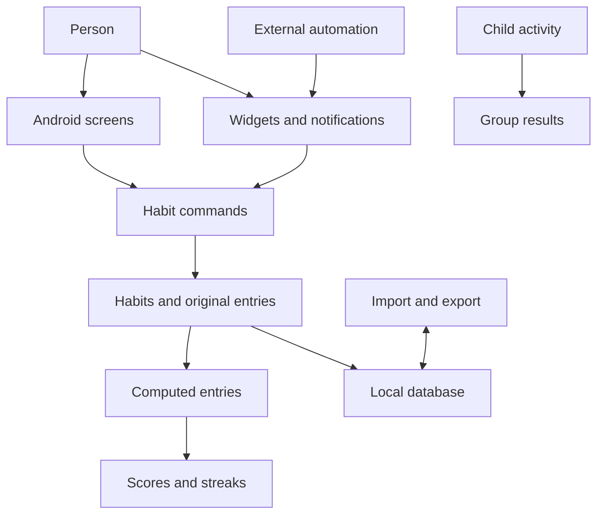

# Domain guide

## Scope

This guide maps the non-web habit domain to its source code.
The [glossary](../CONTEXT.md) defines the domain terms.
The links below identify the authorities for implementation behavior.
Consult those sources for exact rules, formulas, values, and configuration.

This guide covers the core model, Android integrations, data transfer, tests, and repository support areas.
It excludes `web/` and browser-specific adapters.
It does not claim a line-by-line audit of every source file or resource.
Generated outputs and dependency caches do not define the domain.

## Model boundaries

The repository supports one habit domain with several technical layers.
The module split does not establish separate business contexts.
No new architectural decision accompanies this documentation.

The diagram shows conceptual relationships, not a complete call graph.

### Habit definition

Start with [Habit] for the connection between habit settings, recorded activity, and calculated progress.
Use [HabitType] and [NumericalHabitType] for the supported habit variants.
Use [Frequency] for the schedule vocabulary.

A category answers “How do I classify this habit?”
A group habit answers “Which alternative activities contribute to this habit?”
These questions describe different relationships.

The category commands provide the authority for category changes:

- [ChangeHabitCategoryCommand] assigns a category.
- [RenameCategoryCommand] handles a category rename.

### Recorded activity and calculated results

Read [Entry] before interpreting any chart or completion indicator.
Read [EntryList] for the transformation from original entries to computed entries.
Read [Habit.recompute][Habit] for the complete calculation sequence.

Do not treat an unknown day as an explicit negative answer.
Do not treat an automatic completion as recorded activity.
Do not infer target completion from the presence of a numeric value.

The historical name `CreateRepetitionCommand` also covers daily value changes and notes.
Use “original entry” when discussing the complete daily record.
Use “repetition” when discussing an occurrence of activity.

### Group habit and child habit

[HabitList] defines child selection and group calculation.
[SaveHabitGroupCommand] defines the membership edit path.
[DeleteHabitsCommand] defines the removal path.
[HabitGroupTest] provides concrete examples across those operations.

Use these examples when discussing the model:

- A person records a short run below the numeric target.
  The group activity and the running target answer different questions.
- A child receives an automatic completion through its schedule.
  Check the group test before treating that result as group activity.
- A person deletes a group but wants to retain child history.
  Follow the deletion example in the group test.
- A person searches for a child without a matching group name.
  Follow the filtered-list example in the group test.

Do not describe a group as the owner of child history.
Do not describe group completion as the sum of child target results.

### Numeric target and period

[EntryList.recomputeCompletion][EntryList] defines numeric completion.
[EntryListTest] supplies examples for target direction, periods, and skipped days.

Use separate questions for separate concepts:

1. What amount did the person record?
2. Which period contains that date?
3. Does that period meet its target?
4. What result should the interface show for the date?

For example, “at most” describes a limit rather than a minimum amount of activity.
An empty daily record does not necessarily imply an incomplete numeric habit.
Consult the completion tests before changing that interpretation.

### Score and streak

[ScoreList] and [Score] define habit strength.
[StreakList] and [Streak] define continuous completion intervals.
These concepts use different calculations.

A person can retain a strong score after a break in a streak.
Use [ScoreListTest] and [StreakListTest] to explore these differences.
Do not copy the score formula into product documentation.

### Habit lifecycle

Use the [commands] directory to trace user changes.
Start with create, edit, archive, unarchive, and delete commands.
Use [CommandRunner] to trace the task boundary and completion listeners.

Archive and delete represent different user intentions.
Use archive when discussing a retained habit outside the usual active list.
Use delete when discussing removal of the habit and its records.

Read [HabitMatcher] before interpreting a filtered list.
Read [ListHabits] before interpreting the visible group structure.
A filtered view does not define membership or ownership.

## Android boundaries

| Area                  | Source entry point        | Question to investigate                                |
| --------------------- | ------------------------- | ------------------------------------------------------ |
| Application lifecycle | [HabitsApplication]       | Where does the app connect its services?               |
| Screens               | [activities]              | Where does a person create, edit, or inspect a habit?  |
| Widget actions        | [WidgetBehavior]          | Which command changes a daily record?                  |
| Widget updates        | [WidgetUpdater]           | Which changes refresh the home screen?                 |
| Automation            | [FireSettingReceiver]     | How does an external action reach the habit model?     |
| Reminder time         | [ReminderScheduler]       | Which habit and snooze state controls the next prompt? |
| Reminder actions      | [ReminderController]      | How does the app handle a prompt or snooze?            |
| Notification display  | [AndroidNotificationTray] | Which conditions control the visible notification?     |
| Backup copies         | [AutoBackup]              | Which paths manage automatic database copies?          |

Reminders prompt the person; they do not define the habit frequency.
Snooze changes the prompt time, not the habit target.
Widget, notification, and automation actions are entry points into the same habit domain.

## Data boundaries

[SQLiteHabitList] connects habit objects to stored habit records.
[SQLiteEntryList] connects original entries to stored daily records.
[HabitRepository] and [EntryRepository] provide the database boundary.
The [migration resources] and their [tests][migration tests] define database evolution.

Use [GenericImporter] to locate the supported import paths.
Use [LoopDBImporter] to investigate identity across Loop database imports.
Use [HabitsCSVExporter] to investigate spreadsheet output.
Do not assume that a spreadsheet export provides the same recovery path as a database copy.

The local database identifier and the habit UUID serve different integration needs.
Check the Loop import path before discussing duplicate habits or cross-file identity.
Do not use a habit name as its identity.

## Date boundary

[Dates] supplies calendar dates and the current domain day.
[DateUtils] supplies JVM clock and timezone operations.
[MidnightTimer] handles the change of day for its listeners.

Keep the habit date separate from the instant when Android delivers a notification.
Check both date boundaries when investigating midnight or timezone behavior.
Use [date tests] and [reminder tests] for examples.

## Repository map

| Area               | Role                                              | Authority                                        |
| ------------------ | ------------------------------------------------- | ------------------------------------------------ |
| `uhabits-core/`    | Shared model, use cases, and presentation support | [core sources]                                   |
| `uhabits-android/` | Android interface and platform integrations       | [Android sources]                                |
| Core tests         | Domain examples and regression checks             | [common tests], [JVM tests]                      |
| Android tests      | Device and platform checks                        | [Android module]                                 |
| `docs/`            | Contributor and operator guidance                 | [build guide], [test guide], [contributor guide] |
| `gradle/`          | Dependency and build support                      | [Gradle directory]                               |
| Root build files   | Module and task configuration                     | [settings], [root build], [build script]         |
| `tools/`           | Test support utility                              | [tools]                                          |
| `screenshots/`     | Product illustrations                             | [README]                                         |
| Translation files  | Contributor credits and localized resources       | [Android resources], [README]                    |
| Legal files        | License and attribution terms                     | [license], [notice]                              |

Follow the existing build and test guides instead of copying their commands here.
Consult the build files for active targets and dependencies.

## Open domain questions

These questions need explicit product intent before anyone changes the model.
They do not record new decisions.

1. Should an archived child still contribute historical or current group activity?
   Start with [HabitList] and [HabitGroupTest].
2. Should an “at most” child contribute positive activity to a group after it exceeds its limit?
   Compare group activity with numeric completion in [HabitList] and [EntryList].
3. Should invalid imported membership fail, detach the child, or preserve the imported relationship?
   Compare [LoopDBImporter] with [SaveHabitGroupCommand].
4. Which period should a custom numeric frequency represent in the interface?
   Compare [Frequency], [EntryList], and the habit editor under [activities].
5. Should unknown days count as successful days for every “at most” use case?
   Use [EntryListTest] to distinguish current behavior from the desired product rule.

## Evidence and limits

This document records a static model survey.
The survey traced representative commands, calculations, persistence paths, and Android entry points.
The survey did not run the application or execute tests.
Source links identify existing evidence; they do not claim that every test currently passes.

[Habit]: ../uhabits-core/src/commonMain/kotlin/org/isoron/uhabits/core/models/Habit.kt
[HabitType]: ../uhabits-core/src/commonMain/kotlin/org/isoron/uhabits/core/models/HabitType.kt
[NumericalHabitType]: ../uhabits-core/src/commonMain/kotlin/org/isoron/uhabits/core/models/NumericalHabitType.kt
[Frequency]: ../uhabits-core/src/commonMain/kotlin/org/isoron/uhabits/core/models/Frequency.kt
[Entry]: ../uhabits-core/src/commonMain/kotlin/org/isoron/uhabits/core/models/Entry.kt
[EntryList]: ../uhabits-core/src/commonMain/kotlin/org/isoron/uhabits/core/models/EntryList.kt
[HabitList]: ../uhabits-core/src/commonMain/kotlin/org/isoron/uhabits/core/models/HabitList.kt
[HabitMatcher]: ../uhabits-core/src/commonMain/kotlin/org/isoron/uhabits/core/models/HabitMatcher.kt
[Score]: ../uhabits-core/src/commonMain/kotlin/org/isoron/uhabits/core/models/Score.kt
[ScoreList]: ../uhabits-core/src/commonMain/kotlin/org/isoron/uhabits/core/models/ScoreList.kt
[Streak]: ../uhabits-core/src/commonMain/kotlin/org/isoron/uhabits/core/models/Streak.kt
[StreakList]: ../uhabits-core/src/commonMain/kotlin/org/isoron/uhabits/core/models/StreakList.kt
[commands]: ../uhabits-core/src/commonMain/kotlin/org/isoron/uhabits/core/commands
[CommandRunner]: ../uhabits-core/src/commonMain/kotlin/org/isoron/uhabits/core/commands/CommandRunner.kt
[ChangeHabitCategoryCommand]: ../uhabits-core/src/commonMain/kotlin/org/isoron/uhabits/core/commands/ChangeHabitCategoryCommand.kt
[RenameCategoryCommand]: ../uhabits-core/src/commonMain/kotlin/org/isoron/uhabits/core/commands/RenameCategoryCommand.kt
[SaveHabitGroupCommand]: ../uhabits-core/src/commonMain/kotlin/org/isoron/uhabits/core/commands/SaveHabitGroupCommand.kt
[DeleteHabitsCommand]: ../uhabits-core/src/commonMain/kotlin/org/isoron/uhabits/core/commands/DeleteHabitsCommand.kt
[HabitGroupTest]: ../uhabits-core/src/commonTest/kotlin/org/isoron/uhabits/core/models/HabitGroupTest.kt
[EntryListTest]: ../uhabits-core/src/commonTest/kotlin/org/isoron/uhabits/core/models/EntryListTest.kt
[ScoreListTest]: ../uhabits-core/src/commonTest/kotlin/org/isoron/uhabits/core/models/ScoreListTest.kt
[StreakListTest]: ../uhabits-core/src/commonTest/kotlin/org/isoron/uhabits/core/models/StreakListTest.kt
[ListHabits]: ../uhabits-core/src/commonMain/kotlin/org/isoron/uhabits/core/ui/screens/habits/list/ListHabits.kt
[HabitsApplication]: ../uhabits-android/src/main/java/org/isoron/uhabits/HabitsApplication.kt
[activities]: ../uhabits-android/src/main/java/org/isoron/uhabits/activities
[WidgetBehavior]: ../uhabits-core/src/commonMain/kotlin/org/isoron/uhabits/core/ui/widgets/WidgetBehavior.kt
[WidgetUpdater]: ../uhabits-android/src/main/java/org/isoron/uhabits/widgets/WidgetUpdater.kt
[FireSettingReceiver]: ../uhabits-android/src/main/java/org/isoron/uhabits/automation/FireSettingReceiver.kt
[ReminderScheduler]: ../uhabits-core/src/jvmMain/java/org/isoron/uhabits/core/reminders/ReminderScheduler.kt
[ReminderController]: ../uhabits-android/src/main/java/org/isoron/uhabits/receivers/ReminderController.kt
[AndroidNotificationTray]: ../uhabits-android/src/main/java/org/isoron/uhabits/notifications/AndroidNotificationTray.kt
[AutoBackup]: ../uhabits-android/src/main/java/org/isoron/uhabits/database/AutoBackup.kt
[SQLiteHabitList]: ../uhabits-core/src/commonMain/kotlin/org/isoron/uhabits/core/models/sqlite/SQLiteHabitList.kt
[SQLiteEntryList]: ../uhabits-core/src/commonMain/kotlin/org/isoron/uhabits/core/models/sqlite/SQLiteEntryList.kt
[HabitRepository]: ../uhabits-core/src/commonMain/kotlin/org/isoron/uhabits/core/database/HabitRepository.kt
[EntryRepository]: ../uhabits-core/src/commonMain/kotlin/org/isoron/uhabits/core/database/EntryRepository.kt
[migration resources]: ../uhabits-core/assets/main/migrations
[migration tests]: ../uhabits-core/src/commonTest/kotlin/org/isoron/uhabits/core/database/migrations
[GenericImporter]: ../uhabits-core/src/commonMain/kotlin/org/isoron/uhabits/core/io/GenericImporter.kt
[LoopDBImporter]: ../uhabits-core/src/commonMain/kotlin/org/isoron/uhabits/core/io/LoopDBImporter.kt
[HabitsCSVExporter]: ../uhabits-core/src/commonMain/kotlin/org/isoron/uhabits/core/io/HabitsCSVExporter.kt
[Dates]: ../uhabits-core/src/commonMain/kotlin/org/isoron/platform/time/Dates.kt
[DateUtils]: ../uhabits-core/src/jvmMain/java/org/isoron/platform/time/DateUtils.kt
[MidnightTimer]: ../uhabits-core/src/jvmMain/java/org/isoron/uhabits/core/utils/MidnightTimer.kt
[date tests]: ../uhabits-core/src/jvmTest/java/org/isoron/platform/time/DateUtilsTest.kt
[reminder tests]: ../uhabits-core/src/jvmTest/java/org/isoron/uhabits/core/reminders/ReminderSchedulerTest.kt
[core sources]: ../uhabits-core/src
[Android sources]: ../uhabits-android/src/main
[common tests]: ../uhabits-core/src/commonTest
[JVM tests]: ../uhabits-core/src/jvmTest
[Android module]: ../uhabits-android
[build guide]: BUILD.md
[test guide]: TEST.md
[contributor guide]: GUIDELINES.md
[Gradle directory]: ../gradle
[settings]: ../settings.gradle.kts
[root build]: ../build.gradle.kts
[build script]: ../build.sh
[tools]: ../tools
[README]: ../README.md
[Android resources]: ../uhabits-android/src/main/res
[license]: ../LICENSE.txt
[notice]: ../NOTICE.md
